# Foundry Toolkit for VS Code

1. First install Foundry tool kit.

   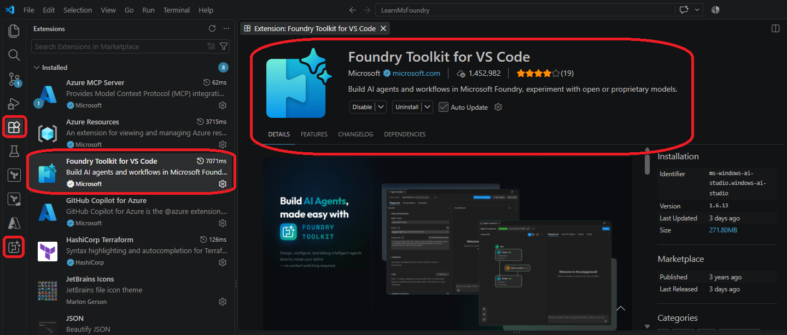

1. Install Prerequisites. Install wsl, windows subsystem for linux

   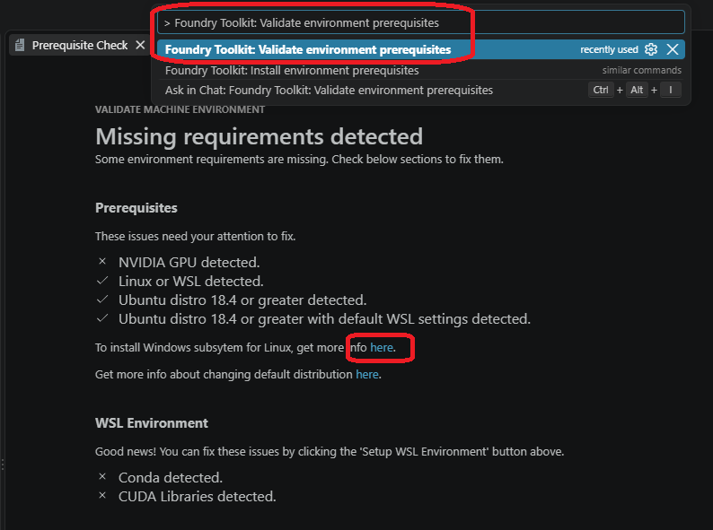

1. Then install Ubuntu. First check for existing installations.

   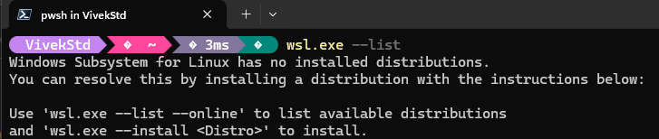

1. Install Ubuntu [as mentioned here.](https://learn.microsoft.com/en-us/windows/wsl/install#change-the-default-linux-distribution-installed)

   ```ps
   wsl.exe --install -d Ubuntu
   ```

   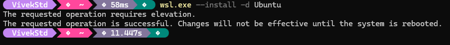

1. Downloading

   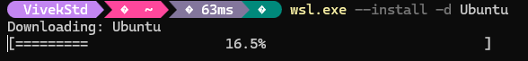

1. Installing

   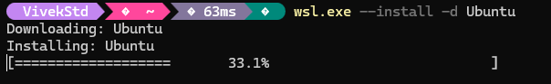

1. After installation

   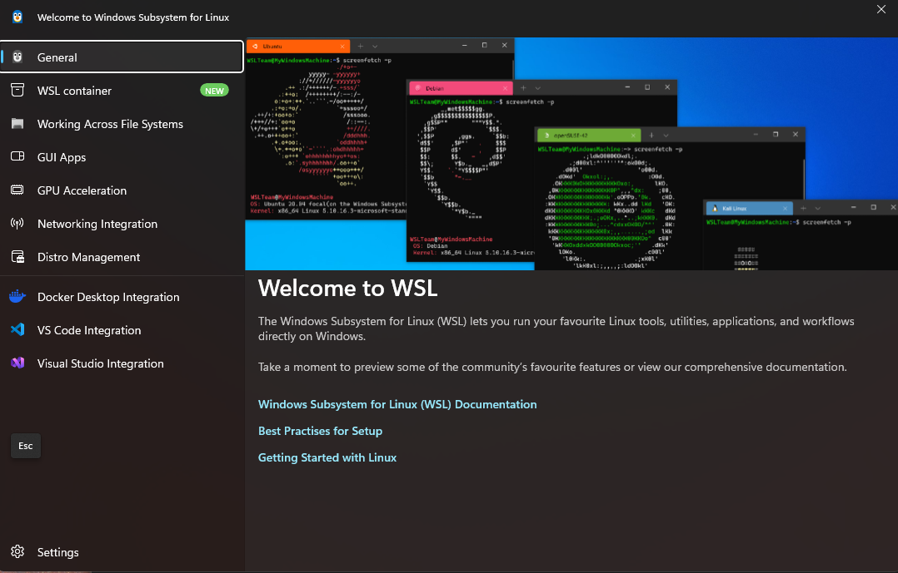

1. Once the prerequisites are set up, then start the foundry tool kit interface by clicking the following icon. Then expand Help and Feedback and click Ask Copilot

   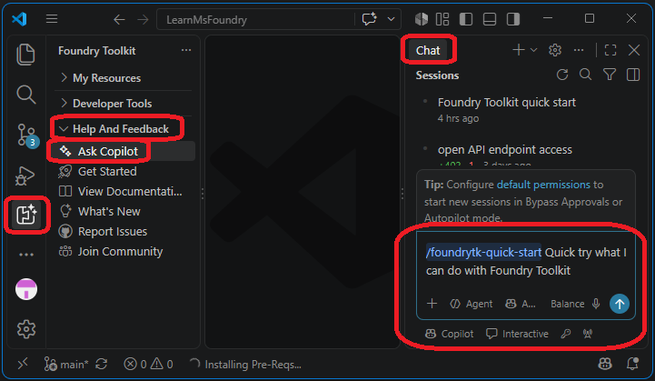

1. Select set up foundry

   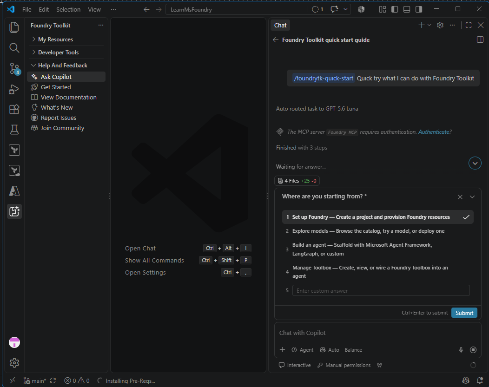

1. Tell copilot if you have a subscription.

   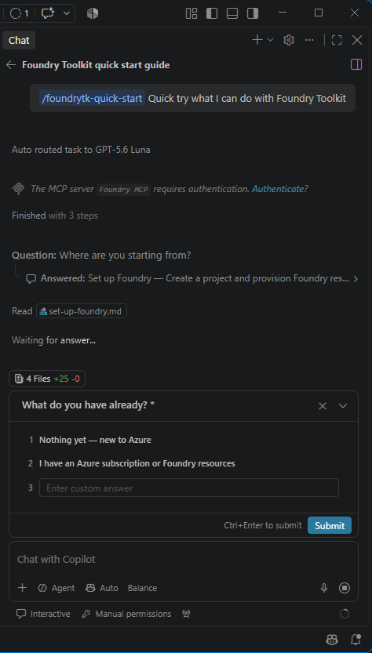

1. Follow the instructions to start creating the project.

   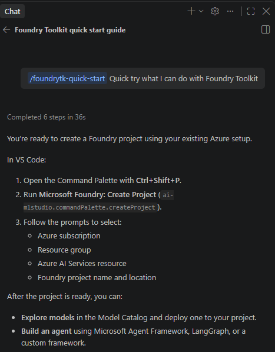

1. From the command palette create project.

   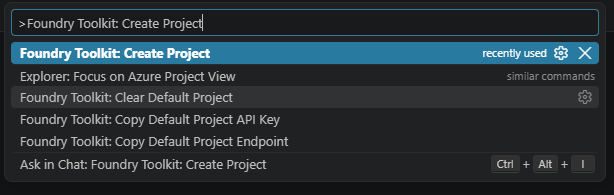

1. Select subscription

   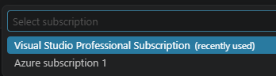

1. Create or choose resource group

   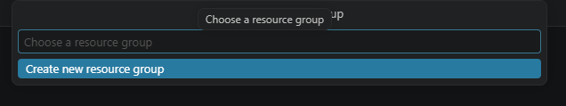

1. Give a name to resource group

   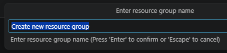

1. Choose a location

   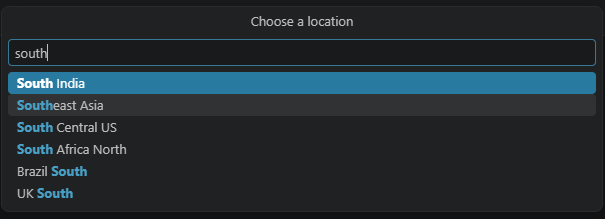

1. Now create project name

   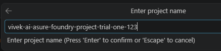

1. Project creation happening. Look bottom right of VS Code.

   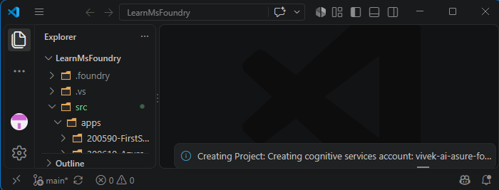

1. Deploy model. Once the project is deployed successfully, you can see a prompt in botton right to deploy a new model. Click that and model catelog will show up.

   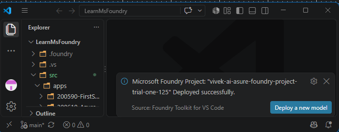

1. If the model catelog is closed, you can open the model catelog as follows. Right click the Models under My Resources and select Deploy new AI model

   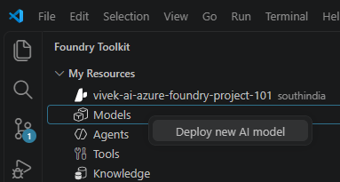

1. You can use the Command Palette also to open the model catelogue.

   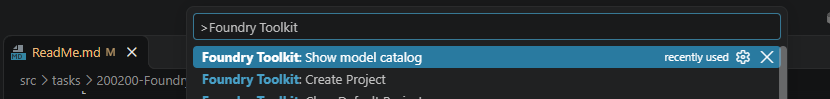

1. Model Catelogue looks as follows. Do ensure VPN is disconnected.

   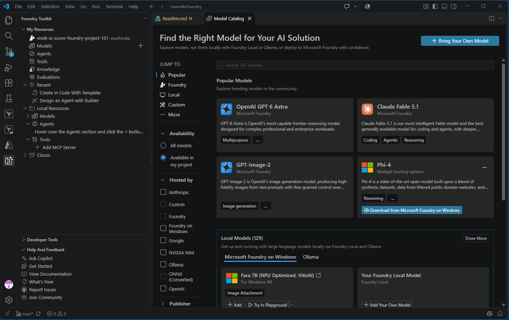

1. Filter models, search for some model, and then hover over a model. Then deploy it as follows.

   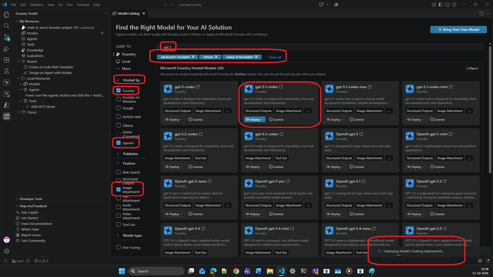

## References

1. https://code.visualstudio.com/docs/intelligentapps/overview#_install-and-setup
2. https://code.visualstudio.com/docs/intelligentapps/overview#_verifying-and-installing-foundry-toolkit-pre-requisites-local-models
3. https://learn.microsoft.com/en-us/windows/wsl/install
4. [Your Entire Agentic AI Workflow Now Inside VS Code](https://www.youtube.com/watch?v=aQFSDGAk9DA)
5. The [full playlist](https://www.youtube.com/playlist?list=PLJfWOmd-Usr4)
6. Another [play list](https://www.youtube.com/playlist?list=PLj6YeMhvp2S536NVc7_vp8bBXiIbdr9Ik)


